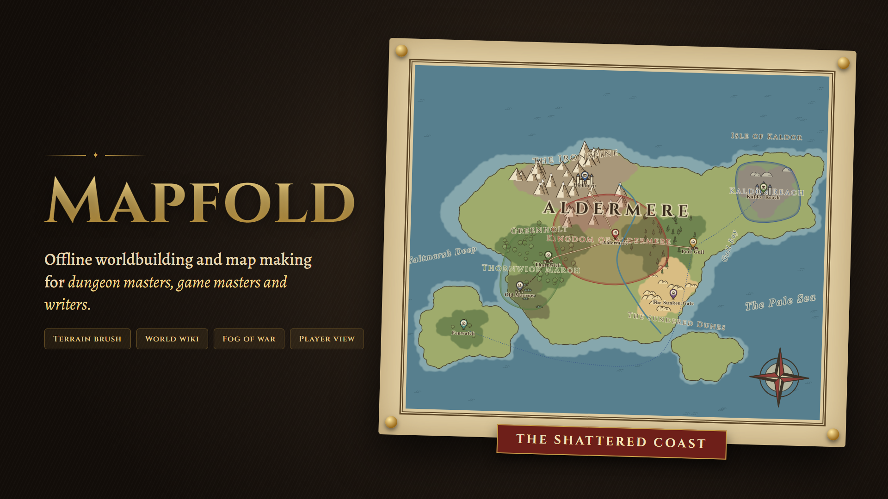
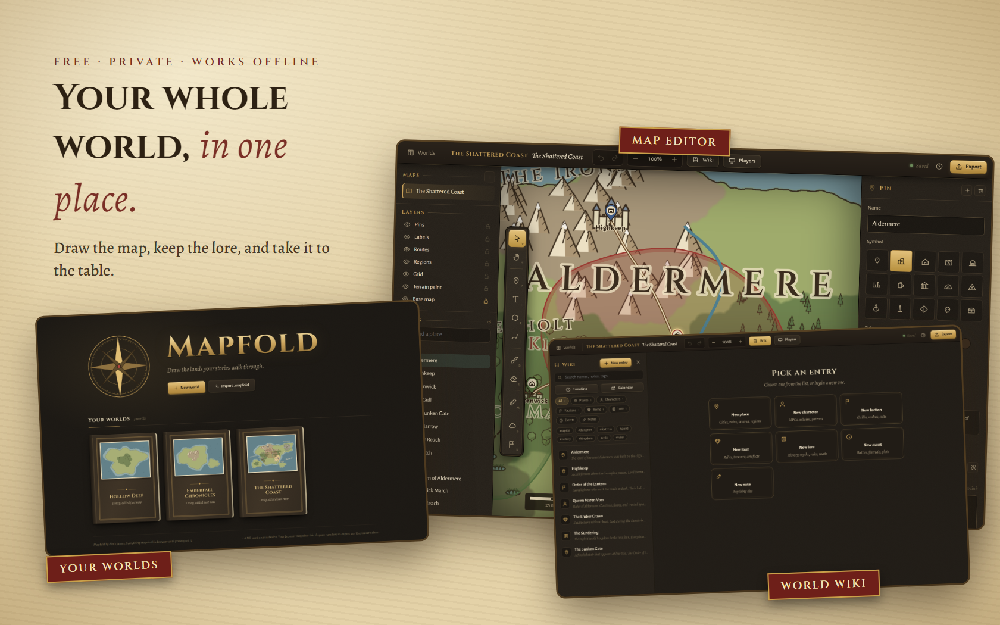

# Mapfold

**Offline worldbuilding and map making for dungeon masters, game masters and writers.**

## About

Mapfold lets you draw maps, write down your world, and take it all to the table. Paint terrain, drop pins, name regions, and keep every character, place and story in a wiki that links to the map.

Everything is saved in your browser. Nothing is uploaded anywhere. Export a `.mapfold` file to back up a world or move it to another device. Mapfold is the sister app of **Inkfold**.

*The world in these pictures, The Shattered Coast, is a sample made for this page.*

**[Try it: direkjames.github.io/Mapfold](https://direkjames.github.io/Mapfold/)**

## Features

**Worlds and maps**
- A **worlds shelf** with thumbnails, where you can rename, export, delete and import worlds
- **Several maps per world**, from blank parchment (four sizes and four parchment styles) or from your own image
- **Maps inside maps:** a pin can open a child map, with a breadcrumb trail so you always know where you are

**Drawing**
- **Terrain brush** with eight land and sea paints, plus stamps for mountains, hills, trees, pines, reeds, waves, dunes, marsh, towns, castles and ruins, and an ink pen
- **Outline coasts** to ink a coastline wherever sea meets land
- **Pins** with 15 symbols, **labels** in five lettering styles, **regions** with fill and border, and **routes** (road, trail, river and sea lane) with length and travel time
- **Grid** (square or hex), map scale, scale bar and a measure tool
- **Layers** you can show, hide and lock
- **Undo and redo** for everything, including brush strokes, and autosave as you work

**The world wiki**
- Entries for **places, characters, factions, items, lore, events and notes**, with aliases, tags and free-form notes
- **`[[Links]]`** between entries that never break when you rename something, with previews on hover
- **Search everywhere** and a quick switcher (`Ctrl+K`)
- **Factions with territory:** give a region a faction and it takes its color, with an optional map key
- A **calendar and timeline** you set up yourself, with events tied to places

**At the table**
- **Player view:** a second window for your TV or projector that shows only what players should see
- **Fog of war:** paint to reveal or cover parts of the map
- **Party and travel:** place a party token and travel along roads, trails and rivers, with days passing on your calendar
- **Secrets:** mark anything as secret, or hide text with `||double bars||`. Secrets stay out of player views and exports.

**Sharing and exporting**
- Export a **world file** (`.mapfold`), a **full-size PNG** (player image or GM copy), or **share with Inkfold** to bring your maps and places into your story
- **Installable and offline** after your first visit

Press `?` in the editor for every keyboard shortcut.

## Getting started

1. Open [direkjames.github.io/Mapfold](https://direkjames.github.io/Mapfold/) in your browser.
2. Press **New world**, pick a map size and a parchment, or use your own image.
3. Paint terrain, then add pins, labels, regions and routes.
4. Press **W** to open the wiki and write down who and what is on your map.
5. Press **Export** to save a `.mapfold` backup or a PNG.

To use it like an app, press **Install** in your browser.

## Requirements

- A modern web browser (Chrome, Edge, Firefox or Safari) on a computer. A large screen works best.

## Built with

- HTML, CSS and JavaScript, with no build step and no dependencies
- IndexedDB for saving, and a service worker for offline use
- Alegreya, Alegreya Sans and Cinzel fonts (SIL Open Font License), bundled with the app

Want to run it yourself? See [Developing Mapfold](docs/DEVELOPING.md).

## Status

Shipped.

## Credits / License

Made by [direkjames](https://github.com/direkjames). See [LICENSE](LICENSE).
